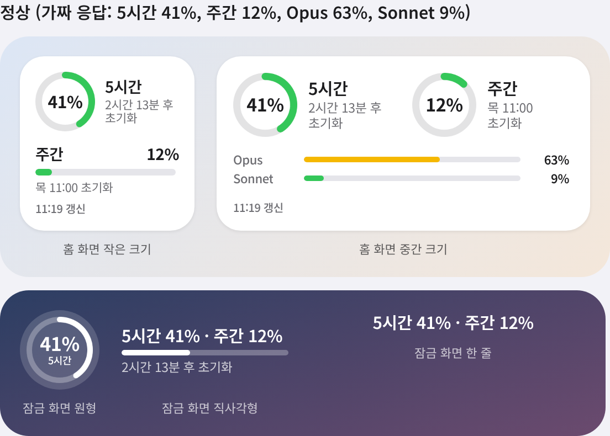

# Claude 사용량 위젯 설치 안내

아이폰 홈 화면과 잠금 화면에서 Claude 사용량(5시간 한도, 주간 한도)을 바로 볼 수 있게 해 주는 위젯입니다.
코딩 지식 없이 **아이폰에서 탭하고 붙여넣는 것만으로** 설치할 수 있습니다. 10분 정도 걸립니다.



> 참고: 위 그림은 가짜 데이터로 만든 미리보기입니다. 실제 아이폰에서는 글꼴이 조금 다르게 보일 수 있어요.
> 다크 모드 그림: [docs/previews/preview-dark.png](docs/previews/preview-dark.png) · 여러 상황별 화면: [docs/previews/preview-all-states.png](docs/previews/preview-all-states.png)

---

## 시작하기 전에 알아 둘 점

- 이 위젯은 Anthropic이 공식으로 제공하는 기능이 아니에요. claude.ai 사용량 화면이 쓰는 주소를 빌려 쓰기 때문에, **claude.ai가 바뀌면 언제든 작동이 멈출 수 있어요.** 그러면 위젯에 "데이터 형식 변경됨"이 뜨고, Claude Code에 고쳐 달라고 하면 됩니다.
- 위젯은 사용량을 **읽기만** 해요. 계정 설정을 바꾸거나 메시지를 보내지 않아요.
- 값은 **실시간이 아니에요.** 15분마다 갱신을 요청하지만, 실제 갱신 시점은 iOS가 정해서 15~30분 이상 늦을 수 있어요.
- 자동으로 접속하는 방식이라 이용약관상 문제가 될 소지가 조금 있어요. 본인 계정으로, 15분 이상 간격을 두고 조회만 하도록 만들었지만, 사용할지는 직접 판단해 주세요.

---

## 1단계. Scriptable 앱 설치

1. 앱스토어에서 **Scriptable**을 검색해 설치합니다. 무료이고, 개발사는 Simon B. Støvring입니다.
2. 한 번 열어서 첫 화면이 나오는지 확인합니다.

## 2단계. 위젯 스크립트 옮기기

1. 아이폰 **Safari**에서 아래 주소를 엽니다. 글자가 가득한 화면이 나오면 정상이에요.
   ```
   https://raw.githubusercontent.com/scent1922/week1step2/main/claude-usage-widget.js
   ```
2. 화면의 글자를 길게 누르고 → **전체 선택** → **복사**를 누릅니다.
3. Scriptable 앱을 열고 오른쪽 위 **＋** 버튼을 누릅니다.
4. 빈 화면을 한 번 탭하고 **붙여넣기**를 누릅니다.
5. 화면 맨 위의 제목(Untitled Script)을 눌러 이름을 **Claude 사용량**으로 바꿉니다.
6. 왼쪽 위 **Done(완료)**을 누릅니다. 스크립트 목록에 "Claude 사용량"이 생기면 성공입니다.

> 저장소 이름을 나중에 바꾸면 1번 주소의 `week1step2` 부분도 새 이름으로 바뀝니다.

## 3단계. 처음 실행하고 로그인하기

Scriptable 목록에서 **Claude 사용량**을 탭하면 "로그인 방법 선택" 창이 뜹니다. 두 가지 방법이 있어요.

| | ① 앱 안에서 로그인 | ② 쿠키 붙여넣기 |
| --- | --- | --- |
| 준비물 | 아이폰만 있으면 됨 | PC(또는 Mac)가 필요함 |
| 안전성 | 더 안전함(로그인 정보를 옮길 필요 없음) | 복사한 값을 조심해서 다뤄야 함 |
| 위젯 자동 갱신 | **iOS 제한 때문에 안 될 수도 있음**(설정 후 자동으로 확인해 줌) | 가장 확실함 |

**먼저 ①을 해 보고, 위젯이 자동 갱신되지 않으면 ②로 바꾸는 것을 추천해요.**

### ① 앱 안에서 로그인

1. **① 앱 안에서 로그인**을 누르고 안내 창에서 **확인**을 누릅니다.
2. claude.ai 화면이 열리면 평소처럼 로그인합니다.
   - **Google로 계속하기 버튼은 이 화면에서 막힐 수 있어요.** 그럴 때는 이메일 주소를 입력하고, 메일로 받은 코드나 링크로 로그인하세요. Google로 가입한 계정도 같은 Gmail 주소를 입력하면 됩니다.
3. 로그인이 끝나 사용량 화면이나 채팅 화면이 보이면, 화면 위쪽의 **닫기(Close)** 버튼을 누릅니다.
4. "연결 성공" 창이 뜨고 현재 사용량이 보이면 끝입니다.

### ② 쿠키 붙여넣기

`sessionKey`라는 값을 PC에서 복사해 아이폰에 붙여넣는 방식입니다.

> ⚠️ **sessionKey는 비밀번호와 같아요.** 이 값을 가진 사람은 내 Claude 계정을 쓸 수 있어요.
> 카카오톡, 메일, 메신저로 보내지 말고, 누구에게도 보여주지 마세요.
> 위젯은 이 값을 아이폰의 키체인(암호화 저장소)에만 저장하고, 화면이나 기록에 표시하지 않아요.

**PC에서 값 복사하기 (Chrome 기준)**

1. PC의 Chrome에서 claude.ai에 로그인합니다.
2. 키보드에서 **F12**를 누릅니다. Mac에서는 **⌥ Option + ⌘ Command + I**를 누릅니다.
3. 오른쪽(또는 아래)에 열린 창의 위쪽 탭에서 **Application**(한국어로는 "애플리케이션")을 누릅니다. 탭이 안 보이면 **»**를 눌러 찾습니다.
4. 왼쪽 목록에서 **Cookies(쿠키)** → **https://claude.ai**를 누릅니다.
5. 표에서 Name이 **sessionKey**인 줄을 찾아, **Value** 칸을 더블클릭해 전체를 복사합니다. `sk-ant-`로 시작하는 긴 값이에요.

**아이폰으로 옮기기**

- Mac과 아이폰이 같은 Apple ID라면: Mac에서 복사한 뒤 아이폰에서 바로 붙여넣으면 됩니다(유니버설 클립보드).
- 그 외에는: 아이폰 메모 앱에 손으로 옮기거나, 안전한 방법으로 옮긴 뒤 **붙여넣고 나서 메모를 바로 지워 주세요.**

**아이폰에서 붙여넣기**

1. Scriptable에서 **Claude 사용량**을 실행하고 **② 쿠키 붙여넣기**를 누릅니다.
2. 입력 칸에 붙여넣고 **저장하고 확인**을 누릅니다.
3. "연결 성공" 창이 뜨면 끝입니다.

> sessionKey는 시간이 지나면 만료돼요. 위젯에 "다시 로그인 필요"가 뜨면 이 과정을 다시 하면 됩니다.

## 4단계. 미리보기로 확인하기

Scriptable에서 **Claude 사용량**을 실행하면 메뉴가 나옵니다.

- **지금 새로고침하고 위젯 보기**: 실제 사용량을 받아 와서, 고른 크기의 위젯 모양으로 보여 줍니다.
- **가짜 데이터로 미리보기**: 로그인 없이 위젯 모양만 볼 수 있어요.

claude.ai 사용량 화면(설정 → 사용량)과 숫자가 같은지 비교해 보세요. 몇 분 차이는 정상입니다.

## 5단계. 홈 화면에 위젯 추가하기

1. 홈 화면의 빈 곳을 길게 눌러 아이콘이 흔들리게 합니다.
2. 왼쪽 위 **편집** → **위젯 추가**를 누릅니다(iOS 버전에 따라 **＋** 버튼).
3. 목록에서 **Scriptable**을 찾아 누릅니다.
4. **작은 크기** 또는 **중간 크기**를 골라 **위젯 추가**를 누릅니다.
5. 홈 화면에 생긴 위젯을 길게 눌러 **위젯 편집**을 누릅니다.
6. **Script**를 눌러 **Claude 사용량**을 고릅니다. 나머지 항목은 그대로 두세요.
7. 빈 곳을 눌러 편집을 마칩니다. 잠시 후 사용량이 표시됩니다.

## 6단계. 잠금 화면에 위젯 추가하기

1. 잠금 화면을 길게 누른 뒤 **사용자화** → **잠금 화면**을 누릅니다.
2. 시계 아래의 위젯 칸을 누릅니다.
3. **Scriptable**을 찾아 **원형** 또는 **직사각형**을 추가합니다.
4. 추가된 위젯을 한 번 더 눌러 **Script**를 **Claude 사용량**으로 고릅니다.
5. 오른쪽 위 **완료**를 누릅니다.

> 시계 위쪽의 한 줄짜리 위젯 칸에도 넣을 수 있어요. "5시간 41% · 주간 12%"처럼 표시됩니다.

## 7단계. (① 방식만) 위젯 자동 갱신 확인

①(앱 안에서 로그인)을 골랐다면, 위젯을 추가하고 **30분쯤 뒤** Scriptable에서 **Claude 사용량**을 다시 실행해 보세요. 메뉴 위쪽에 결과가 나옵니다.

- **위젯 자동 갱신: 정상** → 그대로 쓰시면 됩니다.
- **위젯 자동 갱신: 작동 안 함** → "쿠키 방식으로 바꾸기" 창이 자동으로 뜹니다. ② 방식으로 바꿔 주세요.

위젯에 **"위젯 갱신 불가"**가 보일 때도 같은 뜻입니다.

---

## 위젯 읽는 법

| 표시 | 뜻 |
| --- | --- |
| 초록 / 노랑 / 빨강 | 사용량 0–49% / 50–79% / 80% 이상 |
| 2시간 13분 후 초기화 | 한도가 초기화되기까지 남은 시간(1시간 미만이면 "47분 후") |
| 목 11:00 초기화 | 하루 이상 남았을 때는 요일과 시각(한국 시간) |
| 대기 중 | 아직 세션을 시작하지 않아 값이 비어 있음(0%) |
| 09:15 갱신 | 마지막으로 값을 받아 온 시각 |
| 23분 전 기준 | 인터넷이 끊기는 등의 이유로, 23분 전에 받은 값을 보여 주는 중 |

위젯을 탭하면 claude.ai 사용량 화면이 열립니다. 라이트·다크 모드에 맞춰 색이 자동으로 바뀝니다.

## 문제가 생겼을 때

| 위젯에 보이는 문구 | 이유 | 할 일 |
| --- | --- | --- |
| 다시 로그인 필요 (회색) | 로그인이 만료됐거나 로그인 정보가 없음 | Scriptable에서 스크립트를 실행해 다시 로그인 |
| 23분 전 기준 | 인터넷 끊김, 잠시 요청이 많음 등 | 기다리면 자동으로 회복 |
| 접속 차단됨 | claude.ai 보안 장치(Cloudflare)가 접속을 막음 | ② 방식을 쓰고 있었다면 ① 방식으로 바꿔 보기 |
| 위젯 갱신 불가 | ① 방식이 iOS 제한으로 위젯에서 작동하지 않음 | 스크립트를 실행해 ② 방식으로 바꾸기 |
| 데이터 형식 변경됨 | claude.ai가 내부 형식을 바꿈 | Claude Code에 "위젯이 데이터 형식 변경됨을 표시해요, 고쳐 주세요"라고 요청 |

**로그인 정보를 지우고 싶을 때:** Scriptable에서 스크립트를 실행 → **로그인 정보 지우기**를 누르면 됩니다. 저장된 로그인 정보와 마지막 사용량 값이 모두 지워집니다.

**위젯에 가짜 데이터를 띄우고 싶을 때:** 위젯 편집 화면의 **Parameter** 칸에 `demo`라고 적으면 로그인 없이 가짜 값이 표시됩니다.

---

## 다 됐는지 확인하기 (1차 완료 기준)

- [ ] 위젯의 5시간·주간 %가 claude.ai 사용량 화면과 같다(몇 분 차이는 괜찮음)
- [ ] 초기화까지 남은 시간이 한국 시간 기준으로 맞다
- [ ] 홈 화면 작은·중간 크기, 잠금 화면 원형·직사각형 4가지가 모두 깨지지 않고 보인다
- [ ] 다크 모드와 라이트 모드에서 모두 잘 보인다
- [ ] 비행기 모드로 바꿔도 마지막 값이 "n분 전 기준"으로 보인다(15분 이상 지나야 바뀜)
- [ ] 메뉴에서 로그인 정보를 지우면 "다시 로그인 필요"가 뜬다
- [ ] 위젯을 탭하면 claude.ai 사용량 화면이 열린다
- [ ] 스크립트 코드 안에 쿠키 값이 들어 있지 않다(키체인에만 저장됨)
